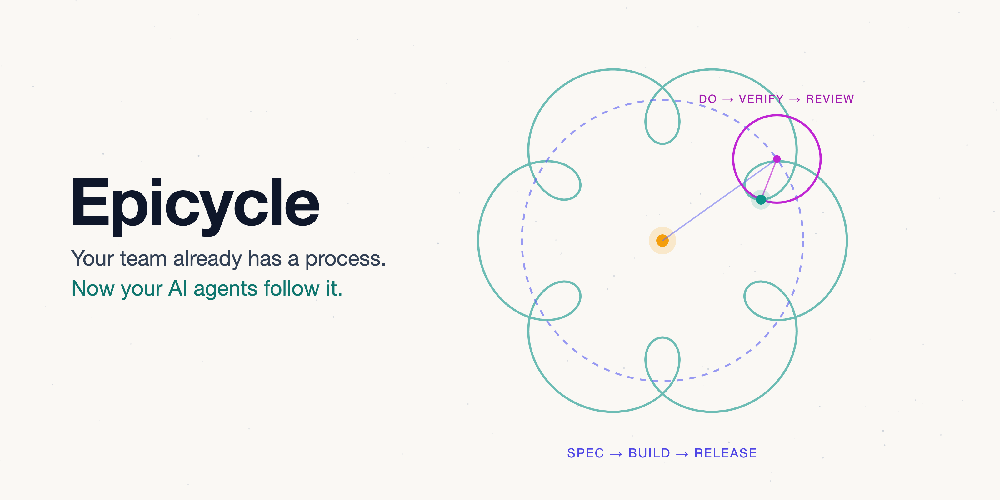
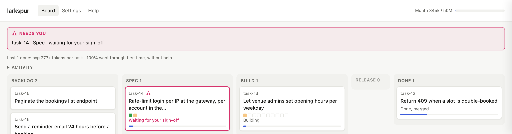
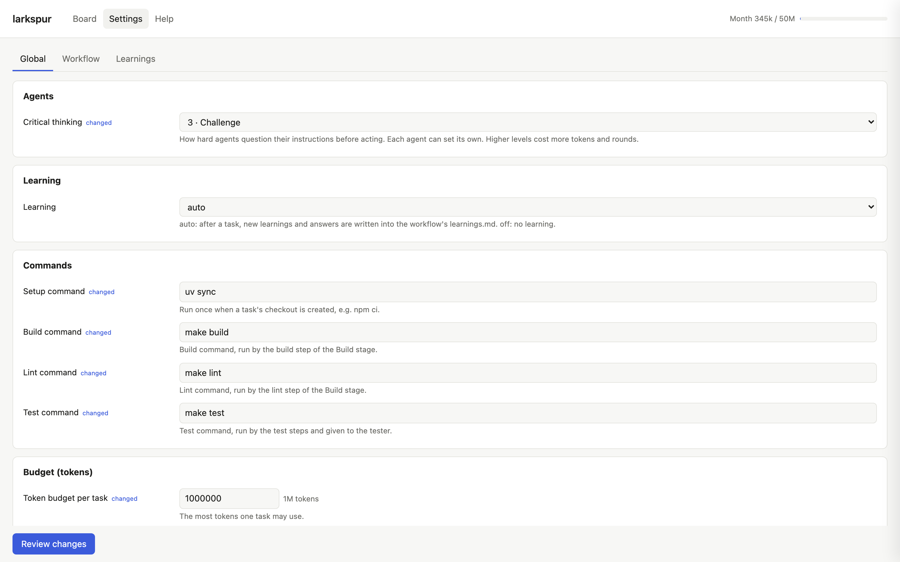
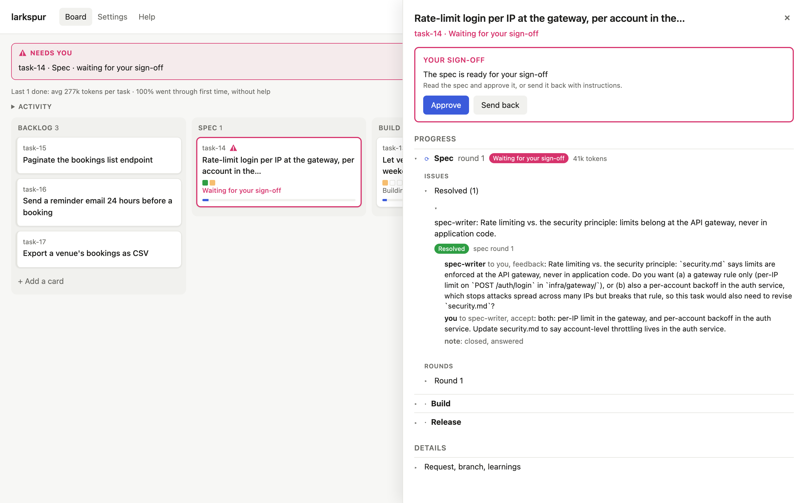

# Epicycle



**Epicycle (`epi`) is a Claude Code plugin that runs a feature from a one-line request to merged code, with AI agents doing the work and you staying in control.**

Your process is described in a **playbook** that lives in your repo and that your team owns. The first playbook, `sdlc`, runs **Spec → Build → Release**:

You describe a feature. A *spec-writer* agent turns it into a spec with testable acceptance criteria. You sign off. A *builder* agent implements it in its own git worktree. Your own lint, build and test commands run, then an independent *tester* and Claude Code's `/code-review` and `/security-review` check the result. Findings go back to the builder, which fixes them or pushes back with evidence. When everything passes and you approve, it merges.

Why use it:

- **Independent checks.** The agent that writes the code is not the one that tests or reviews it.
- **You decide at the points that matter.** Sign-offs on the spec and the build; anything the agents can't settle comes to you.
- **Agents challenge each other.** They question instructions and push back with evidence instead of complying silently.
- **It learns.** After each task a retro writes lessons into `learnings.md`, which later tasks' agents read.
- **It follows your rules.** Repo principles, `CLAUDE.md` and `REVIEW.md` are given to the agents, and guardrails stop them editing protected files or running dangerous commands.
- **It stays on budget.** Token limits per stage, task and month are enforced.
- **It is yours to change.** The playbook is a file in your repo; add a reviewer or a check with one line.

> Status: early and in development (v0.7). It works end to end, but expect rough edges. Issues and feedback are welcome.

## Requirements

- Claude Code with plugin support
- Python 3.9+ and git
- `gh` (optional): used for GitHub pull requests. Without it, Epicycle merges locally.

## Install

In Claude Code:

```text
/plugin marketplace add saket28/Claude-Plugin-Epicycle
/plugin install epi@epicycle-marketplace
```

To try it from a local clone instead: `claude --plugin-dir /path/to/Claude-Plugin-Epicycle`.

## Quick start

Run these inside the repo you want to work on:

```text
/epi:init                                   # one-time setup for this repo
/epi:start Add rate limiting to the login endpoint
/epi:status                                 # see where it is and what needs you
/epi:dashboard                              # optional: the same, in a browser
```

`/epi:init` detects your lint, build and test commands and writes:

| Path | What it is |
|---|---|
| `.claude/epi.md` | Repo-wide settings (commands, budgets, who may approve) |
| `.claude/workflows/sdlc/` | The Spec → Build → Release workflow, which you own and can edit |
| `.claude/agents/sdlc-*.md` | The spec-writer, builder and tester agents |
| `.claude/principles/` | Empty starters for how your repo does things (architecture, design system, personas, security, testing) |
| `REVIEW.md` | What reviewers should and should not report |
| `.epi/` | Task records and local state (gitignored) |

Fill in the principles and `REVIEW.md` a little before your first task. They make the agents' work noticeably better.

## How a task runs

1. **Spec.** The spec-writer writes a short spec with testable acceptance criteria and rates the risk. It may ask you questions. **You sign off** (`/epi:approve <id> spec`) before anything is built.
2. **Build, in rounds.** The builder works in its own checkout (`<repo>.epi-worktrees/task-<n>`, outside your repo).
   - *Verify* runs your `lint`, `build` and `test` commands.
   - *Review* runs only when those pass: an independent tester, `/code-review`, and `/security-review` for medium and high risk.
   - Each finding becomes a thread. The builder fixes it or disputes it with evidence, and whoever raised it accepts or insists.
   - Rounds repeat until nothing blocking is open. If the round limit (default 3) is reached with issues open, the task needs you.
3. **Open the PR and wait for CI.** Failures go back to the builder. Then **you sign off** (`/epi:approve <id> build`, or approve the pull request on GitHub).
4. **Release.** Rebase if needed, run the tests, merge and clean up.

Every task is recorded in `.epi/task-<n>/`: the spec, each round's reports, the conversation, and token usage.

When something needs you, `/epi:status` and the dashboard show it, with the command to move forward.



## Commands

| Command | What it does |
|---|---|
| `/epi:init` | Set up the repo (once) |
| `/epi:intake <text>` | Add a feature to the backlog without starting it |
| `/epi:start [id \| text]` | Start the next backlog item, a card by number, or a new feature; or continue a task |
| `/epi:status [id] [--check]` | Tasks, stages, tokens and anything waiting on you; `--check` is a health check |
| `/epi:approve <id> <approval>` | Sign off a waiting stage (`spec`, `build`), add budget (`budget +500k`), `accept` a disagreement or failure as it is, or `retry` |
| `/epi:send-back <id> [--to <step>] "<instructions>"` | Send a task back to an agent of this stage or an earlier one |
| `/epi:cancel <id>` | Stop a task and remove its checkout (the record and branch are kept) |
| `/epi:review [names] [--base b]` | Run review steps on the current branch, no task needed |
| `/epi:dashboard` | Open the local dashboard (see below) |
| `/epi:install <playbook> [--force]` | Copy a playbook into the repo |
| `/epi:upgrade <playbook> [--dry-run]` | Merge the plugin's newer playbook into your copy |
| `/epi:help [topic]` | Help: `commands`, `flow`, `review-steps`, `settings` |

### The dashboard

`/epi:dashboard` starts a local server (127.0.0.1 only, with a private token in the URL) and opens a board: a column per stage, a strip for what needs you, per-task progress, token use, settings and help. It has buttons for the same decisions as the commands (approve, send back, accept as is, try again) and answer boxes for agents' questions. It can't run agents, so after deciding, run `/epi:start task-<n>` in Claude Code to continue.

## Configuration

Settings live in files you own and commit:

| File | Holds |
|---|---|
| `.claude/epi.md` | `global.*`: commands, budgets, approvers, branches, guardrails, dashboard, board and host |
| `.claude/workflows/sdlc/workflow.yaml` | The stages and steps. Turn a step or sign-off off with `enabled: false` |
| `.claude/workflows/sdlc/settings.md` | `stage.<id>.*` and `agent.<name>.*`; the body holds rules every agent reads |
| `.claude/workflows/sdlc/learnings.md` | Answers and learnings, written by the retro |

`init` writes only what differs from the defaults, so a typical `epi.md` is short:

```yaml
# .claude/epi.md
---
global:
  budget: { per_task: 1500000 }
  command: { setup: npm ci, test: npm test, lint: npm run lint }
  human: { approver: [alice, bob] }
---
```

```markdown
# .claude/workflows/sdlc/settings.md
---
stage:
  build: { rounds: 4 }
agent:
  builder: { critical_thinking: 3 }
---

- Split any feature that touches more than two services into separate tasks.
- The tester must use the fixtures in `test/fixtures`.
```

Commonly changed settings:

| Setting | Default | Meaning |
|---|---|---|
| `global.command.<name>` | none | Your `setup`, `lint`, `build`, `test` and any custom check commands |
| `global.budget.per_task` / `per_month` | 2M / 50M tokens | Token limits; `on_exceed` is `warn` or `escalate` |
| `global.human.approver` | anyone | Who may sign off |
| `global.repo.base_branch` | `main` | The branch tasks start from and merge into |
| `global.pipeline.critical_thinking` | `1` | How hard agents question instructions (0 to 5, below) |
| `stage.<id>.rounds` | `3` | How many Do, Verify, Review rounds a stage may use |
| `agent.<name>.model` | the agent file's | Which model runs an agent |



Run `epi config`, or open the dashboard's Settings tab, to see every setting, its default and help text. The schemas are in `templates/epi.schema.json` and `workflows/sdlc/settings.schema.json`. Run `/epi:status --check` after editing by hand.

### Critical thinking

Agents can question their instructions and push back with evidence. Set the level globally or per agent:

| Level | Name | Behaviour |
|---|---|---|
| 0 | Off | Follows instructions as given |
| 1 | Flag | Objects only to clear contradictions |
| 2 | Check | Checks instructions against the spec, code and rules |
| 3 | Challenge | Questions specs and earlier findings, with evidence |
| 4 | Sceptical | Assumes mistakes until checked |
| 5 | Adversarial | Challenges everything, including the task |

Higher levels cost more tokens and rounds. If a checker keeps a finding the builder disputed, it goes to you: **Accept as is** or **Send back** with instructions.

Here the spec-writer finds that a request conflicts with the repo's security principle, and asks before writing the spec:



### Principles

Principles are markdown files in `.claude/principles/` that say how your repo does things. Each has a `summary`, an `applies_to` list (which agents see it) and an optional `when`. Agents read the ones that apply to them and can't edit them.

## Adding a review step

A review step is one line in a stage's `review:` list in `.claude/workflows/sdlc/workflow.yaml`.

**An agent** (e.g. accessibility). Create `.claude/agents/a11y.md` (a Claude Code subagent with `name`, `description`, `tools`, then instructions), then add:

```yaml
review:
  - { uses: agent/a11y, if: touches-ui }
```

**A command** (a deterministic check). Define it in `.claude/epi.md`, then reference it under `verify:`:

```yaml
global:
  command: { license-check: "npx license-checker --failOn GPL" }
```
```yaml
verify:
  - { run: license-check, if: "paths:[package.json]" }
```

Useful options: `if` (a condition such as `touches-ui` or `risk >= medium`), `enabled: false` (leave the step out), `continue-on-error: true` (advisory only), `always_rerun`. Skills (`uses: skill/<name>`) work too. Full details: `/epi:help review-steps` or [reference/help.md](reference/help.md).

## Permissions and safety

- Agents work in each task's own checkout, outside your repo.
- They run your configured commands through `epi.py run <task> <name>`, which a plugin hook allows without a prompt (in exactly that form only).
- `/epi:init` writes `.claude/settings.local.json` so Claude Code can use the checkout folder (it takes effect after the folder trust prompt) and updates `.gitignore`.
- Guardrails block agents from editing `.claude/epi.md`, workflows, agents, principles, `CLAUDE.md`, `REVIEW.md` and CI files, and from force-pushing, `reset --hard`, or pushing to the base branch. Both lists are settings.
- Token budgets are enforced per stage, task and month.

## Updating

When the plugin ships a newer `sdlc` playbook, run `/epi:upgrade sdlc --dry-run` to preview, then `/epi:upgrade sdlc`. It merges three ways against a pristine copy kept in `.base/`, so your edits survive. If any file conflicts, nothing is written and the conflicts are listed. `/epi:status --check` tells you when an upgrade is available.

## Troubleshooting

| Problem | Try |
|---|---|
| Something looks wrong | `/epi:status --check` |
| A task is stuck | `/epi:status <id>` shows what it's waiting on and the command to continue |
| Over budget | `/epi:approve <id> budget +500k` |
| A step keeps failing | `/epi:approve <id> retry`, or `/epi:send-back <id> "instructions"` |
| A task is no longer wanted | `/epi:cancel <id>` |
| Questions about commands, flow or settings | `/epi:help [topic]` |

## Development

```bash
cd tests && python3 -m unittest            # unit and end-to-end tests with simulated agents, no model calls
claude plugin validate .                   # manifest and component checks

# Evals run real models on your account. Export the claude path so headless reviews work in the sandbox.
export EVAL_EPI_CLAUDE_BIN="$(command -v claude)"
claude plugin eval . --case status-check --scaffold --ablation none \
  --allow-tools "Bash(python3 *)"                                        # cheap (haiku)
claude plugin eval . --tag live --scaffold --ablation none --runs 1 \
  --allow-tools Write Edit "Bash(python3 *)" "Bash(git *)" "Bash(cd *)"   # full tasks, ~$1-2 each
```

Layout: engine in `scripts/engine/`, skills in `skills/`, agents in `agents/`, playbooks in `workflows/`, templates in `templates/`, and the in-product help in `reference/`. Contributor conventions are in [CLAUDE.md](CLAUDE.md). When you change behaviour, keep `README.md` and `reference/help.md` in step.

## License

MIT. See [LICENSE](LICENSE).
